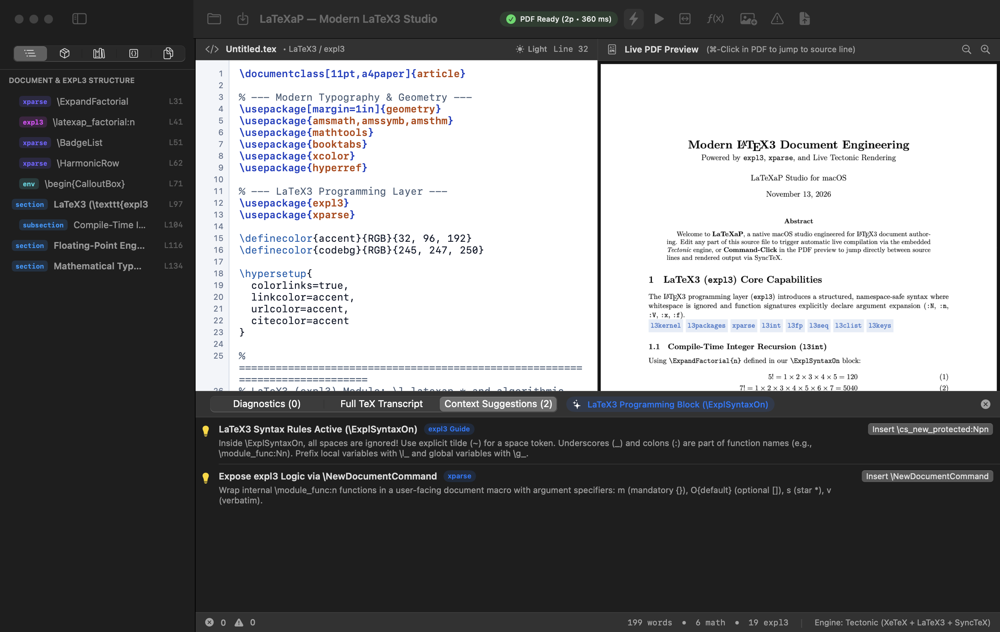
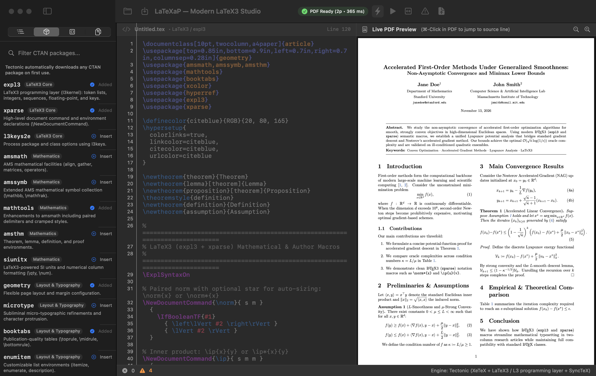
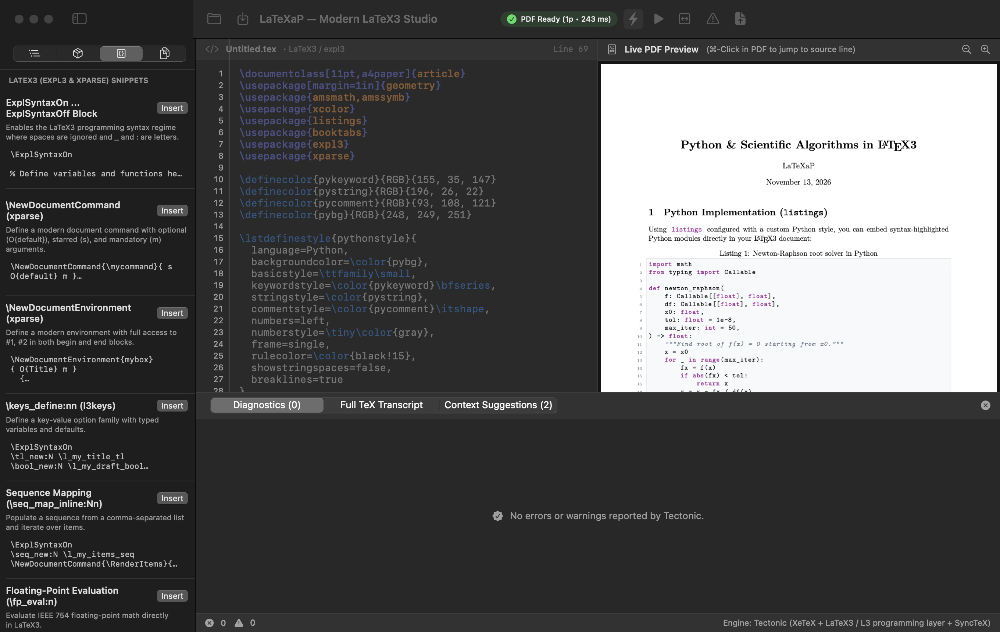

<p align="center">
  
</p>

<h1 align="center">LaTeXaP — Modern macOS LaTeX3 Studio</h1>

<p align="center">
  <strong>Native Swift &amp; SwiftUI Studio for Authoring LaTeX3 (<code>expl3</code> + <code>xparse</code>) Documents with Live Tectonic Rendering &amp; Bidirectional SyncTeX</strong><br/>
  <sub>Latest Release: <strong>v0.3.1</strong> (Build 6) • macOS 14.0+ • Embedded Tectonic 0.17.0</sub>
</p>

---

## Screenshots

### 1. LaTeX3 (`expl3` + `xparse`) Workspace, Structure Outline & Context Suggestions


### 2. Two-Column Academic Research Article & CTAN Package Browser


### 3. Python & Scientific Computing in LaTeX3 + Snippet Library


---

## Key Features

1. **Real-Time LaTeX3 (`expl3` & `xparse`) Compilation**
   - Uses an embedded **Tectonic** engine (`XeTeX` + `LaTeX3` programming layer) with debounced live compilation as you type.
   - Zero TeX Live setup required: Tectonic automatically fetches and caches any missing CTAN packages (`siunitx`, `mathtools`, `tikz`, `booktabs`, `cleveref`, `pythonhighlight`, etc.) on demand.

2. **Split-Pane Native Editor & PDF Preview**
   - **Syntax-Highlighted Editor (`NSTextView`)**: Custom highlighting for `expl3` namespaces (`\module_func:Npn`, `\l_tmpa_tl`, `\ExplSyntaxOn`, `\NewDocumentCommand`, `\keys_define:nn`), standard LaTeX commands, environments, inline math, macro tokens (`#1`, `##1`), and comments.
   - **Real-Time Line Auto-Completion**: Floating completion popup + inline ghost text for `expl3`/`xparse` commands, full `\begin{...}...\end{...}` environment expansion, `\usepackage{...}` catalog completion, and dynamic indexing of user-defined macros in the current document.
   - **Line Number & Diagnostic Gutter**: Displays line numbers, active cursor row, and inline red/amber markers for compilation errors and warnings.
   - **Bidirectional SyncTeX (`SyncTeXParser`)**:
     - **Backward Sync (PDF → Editor)**: **⌘-Click** (or double-click) anywhere in the rendered PDF preview to jump directly to the corresponding line in the `.tex` editor.
     - **Forward Sync (Editor → PDF)**: Click **Sync PDF** (`⇧⌘J`) or click an item in the Outline sidebar to scroll and highlight the corresponding region in the PDF.

3. **Diagnostics, Full TeX Transcript & Context Suggestions Drawer**
   - **Diagnostics**: Structured parser extracts line-accurate LaTeX/Tectonic errors and warnings; click any diagnostic to jump to the offending line.
   - **Full TeX Transcript**: Inspect the complete `.log` output.
   - **Context Suggestions**: Region-aware guidance that adapts to where your cursor is (`Empty Document — Getting Started`, `Document Preamble`, `LaTeX3 Programming Block (\ExplSyntaxOn)`, or active `\begin{...}` environments) with one-click code & package insertion.

4. **Academic Paper Authoring Suite (`v0.2.0`) & Starter Templates**
   - **Academic Templates & Paper Setup Wizard (`⇧⌘N`)**: Ready-to-compile templates for **APA 7th Ed.**, **IEEE Conference**, **ACM Article**, **MLA Essay**, **STEM Lab Report**, **University Thesis**, and **Beamer Slides** (plus LaTeX3 `expl3`/`xparse`, Python scientific computing, and TikZ starters). Configure Title, Author, Institution, Course/Venue, Paper Size, Double-Spacing, and **Anonymized Blind Review** (`lineno`) via the Paper Setup Wizard.
   - **Smart Citations & `.bib` Management (`⇧⌘K`)**: Search **CrossRef** by title/author/keyword or fetch by **DOI / arXiv / ISBN**, drag-and-drop `.bib` files, switch bibliography styles (`APA`, `IEEE`, `ACM`, `MLA`, `Chicago`, `Nature`), and insert `\cite`, `\parencite`, `\textcite`, `\autocite`, or `\footcite` with optional page locators.
   - **Plain-English Error Demystifier & Pre-Flight Checklist**: Translates common TeX errors into student-friendly cards with **1-Click Auto-Fix** actions, and checks unresolved `\cite`/`\ref` keys, uncited `.bib` entries, missing/absolute figure paths, and typography hygiene before submission.
   - **Visual Spreadsheet Table, `pgfplots` Chart & Relative Figure Assistant**: Build `booktabs` tables in a 2D editable grid or CSV mode, generate `pgfplots` line/bar/scatter charts from CSV data, and import/drop images into relative `figures/` folders with single or side-by-side (`subcaption`) layouts.
   - **Rubric Word/Page Budgets, Prose Spellcheck (`⌥⌘;`) & Submission `.zip` Export (`⌥⇧⌘E`)**: Track prose-only, abstract, and page budgets from the status bar (with optional **Student Mode**), toggle LaTeX-aware prose spellcheck, and bundle `.tex`, `.bib`, `figures/`, and fonts into a clean `.zip` archive.

5. **GitHub Repository Multi-Project Storage (`v0.3.0`)**
   - **Connect & Manage GitHub Repositories (`⇧⌘G`)**: Connect an existing GitHub repository or create a new one directly in LaTeXaP using **GitHub CLI (`gh`)**, a **Personal Access Token** stored securely in **macOS Keychain**, or **SSH (`~/.ssh`)**.
   - **Multi-Project Layout (`projects/<slug>/`)**: Organize multiple independent papers, lab reports, and theses inside one repository—each isolated in `projects/<slug>/` with its own `main.tex`, `references.bib`, `figures/`, and `project.json`, coordinated by `.latexap-workspace.json` and a LaTeX `.gitignore` (and auto-discovery/import of existing `.tex` files).
   - **Quick Save & Commit (`⌘S`) & Custom Commit Popover (`⌥⌘S`)**: `⌘S` saves your project files and creates a scoped Git commit using the automatic timestamped message `Update <Project Name> — YYYY-MM-DD HH:mm` (auto-pushing in the background when enabled, or queuing cleanly offline). Press **`⌥⌘S`** (**Save & Commit with Message...**) to inspect changed files, customize the commit message with quick prefixes, and choose whether to push immediately.
   - **Per-Project Commit History & Version Restore (`⌥⌘H`)**: Browse commits scoped to the active project, preview historical file snapshots or diffs, and restore any prior version via a safe forward commit that keeps full history intact.
   - **Automatic Rebase Sync & Guided Conflict Recovery**: Background sync handles upstream updates, pauses compilation on conflicts, and lets you resolve per-file or keep both versions (`Keep Both Copies`, `Keep My Local Version`, or `Use GitHub Version`).

6. **Custom Fonts & Editor Typography (`v0.1.2`)**
   - **Font Manager (`⇧⌘F`) & Fonts Sidebar Tab**: Import local `.ttf`, `.otf`, and `.ttc` font files (via **View → Add Custom Font...**, **Add Font...**, or drag-and-drop), preview live customizable specimens (`10–36 pt`, Light/Dark surface), rename, and safely remove managed fonts with reference-aware confirmation.
   - **XeTeX (`fontspec`) & CTAN Font Presets**: Apply custom fonts or macOS system fonts directly to your document's **Main** (`\setmainfont`), **Sans** (`\setsansfont`), **Mono** (`\setmonofont`), or named **`\newfontfamily`** preamble roles, or insert one-click CTAN font packages (`libertinus`, `ebgaramond`, `fira`, `plex`, `lmodern`, `tgpagella`). Managed fonts are stored non-invasively in `~/Library/Application Support/LaTeXaP/Fonts/` and automatically exposed to Tectonic.
   - **Code Editor Font Picker**: Choose System Monospaced, any macOS monospaced font, or an imported custom font (`10–24 pt`) from the editor header popover or Font Manager, persisted across launches.

7. **PDF & Submission Export**
   - Export compiled PDF documents (**Export PDF** / `⇧⌘E`) or self-contained submission packages (**Export Submission Bundle (.zip)** / `⌥⇧⌘E`).

See [CHANGELOG.md](CHANGELOG.md) for release notes, [docs/github-repo-storage-architecture.md](docs/github-repo-storage-architecture.md) / [docs/github-repo-storage-ux.md](docs/github-repo-storage-ux.md) for v0.3.0 GitHub Multi-Project Storage, [docs/academic-suite-architecture.md](docs/academic-suite-architecture.md) / [docs/academic-suite-ux.md](docs/academic-suite-ux.md) for the v0.2.0 Academic Suite design, and [docs/custom-fonts-architecture.md](docs/custom-fonts-architecture.md) / [docs/custom-fonts-ux.md](docs/custom-fonts-ux.md) for custom font architecture.

---

## Installation

### Option 1: Install Latest Release via Terminal (Recommended — No Gatekeeper Prompt)
Run these commands in Terminal to download the latest release directly from GitHub into `/Applications` and launch **LaTeXaP**:

```bash
curl -fsSL -o /tmp/LaTeXaP.zip https://github.com/jameslloyd/LaTeXaP/releases/latest/download/LaTeXaP-macOS.zip
ditto -x -k /tmp/LaTeXaP.zip /Applications
xattr -cr /Applications/LaTeXaP.app
rm -f /tmp/LaTeXaP.zip
open /Applications/LaTeXaP.app
```

> *Note*: The `.app` bundle includes a standalone, self-contained **Tectonic** typesetting engine — no separate TeX Live, MacTeX, or Homebrew installation is required.

### Option 2: Download from GitHub Releases (Browser)
1. **Download**: Grab the latest `LaTeXaP-macOS.zip` archive from [**GitHub Releases**](https://github.com/jameslloyd/LaTeXaP/releases/latest).
2. **Unzip**: Double-click `LaTeXaP-macOS.zip` in Finder to extract **`LaTeXaP.app`**.
3. **Move to Applications**: Drag **`LaTeXaP.app`** into your **`/Applications`** folder.
4. **Launch**: Open **LaTeXaP** from `/Applications` or Spotlight (`⌘Space`).
   - *macOS Gatekeeper tip*: Because the release binary is ad-hoc signed (not notarized with a paid Apple Developer ID), macOS may show *"Apple could not verify LaTeXaP"* when downloaded through a web browser. Either click **Open Anyway** in **System Settings → Privacy & Security**, or strip the browser quarantine attribute in Terminal:
     ```bash
     xattr -cr /Applications/LaTeXaP.app
     ```

---

## Building from Source

### Run Directly via Swift Package Manager
```bash
git clone https://github.com/jameslloyd/LaTeXaP.git
cd LaTeXaP
swift run
```

### Package Standalone macOS `.app` Bundle (with Embedded Tectonic)
```bash
./scripts/package_app.sh
open build/LaTeXaP.app
```
