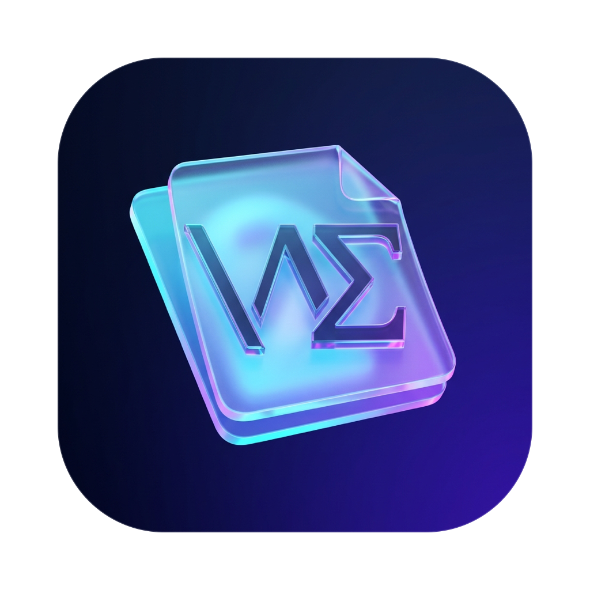

<p align="center">
  
</p>

<h1 align="center">LaTeXaP — Modern macOS LaTeX3 Studio</h1>

<p align="center">
  <strong>Native Swift &amp; SwiftUI Studio for Authoring LaTeX3 (<code>expl3</code> + <code>xparse</code>) Documents with Live Tectonic Rendering &amp; Bidirectional SyncTeX</strong>
</p>

---

## Screenshots

### 1. LaTeX3 (`expl3` + `xparse`) Workspace, Structure Outline & Context Suggestions


### 2. Two-Column Academic Research Article & CTAN Package Browser


### 3. Python & Scientific Computing in LaTeX3 + Snippet Library


---

## Key Features

1. **Real-Time LaTeX3 (`expl3` & `xparse`) Compilation**
   - Uses an embedded **Tectonic** engine (`XeTeX` + `LaTeX3` programming layer) with debounced live compilation as you type.
   - Zero TeX Live setup required: Tectonic automatically fetches and caches any missing CTAN packages (`siunitx`, `mathtools`, `tikz`, `booktabs`, `cleveref`, `pythonhighlight`, etc.) on demand.

2. **Split-Pane Native Editor & PDF Preview**
   - **Syntax-Highlighted Editor (`NSTextView`)**: Custom highlighting for `expl3` namespaces (`\module_func:Npn`, `\l_tmpa_tl`, `\ExplSyntaxOn`, `\NewDocumentCommand`, `\keys_define:nn`), standard LaTeX commands, environments, inline math, macro tokens (`#1`, `##1`), and comments.
   - **Real-Time Line Auto-Completion**: Floating completion popup + inline ghost text for `expl3`/`xparse` commands, full `\begin{...}...\end{...}` environment expansion, `\usepackage{...}` catalog completion, and dynamic indexing of user-defined macros in the current document.
   - **Line Number & Diagnostic Gutter**: Displays line numbers, active cursor row, and inline red/amber markers for compilation errors and warnings.
   - **Bidirectional SyncTeX (`SyncTeXParser`)**:
     - **Backward Sync (PDF → Editor)**: **⌘-Click** (or double-click) anywhere in the rendered PDF preview to jump directly to the corresponding line in the `.tex` editor.
     - **Forward Sync (Editor → PDF)**: Click **Sync PDF** (`⇧⌘J`) or click an item in the Outline sidebar to scroll and highlight the corresponding region in the PDF.

3. **Diagnostics, Full TeX Transcript & Context Suggestions Drawer**
   - **Diagnostics**: Structured parser extracts line-accurate LaTeX/Tectonic errors and warnings; click any diagnostic to jump to the offending line.
   - **Full TeX Transcript**: Inspect the complete `.log` output.
   - **Context Suggestions**: Region-aware guidance that adapts to where your cursor is (`Empty Document — Getting Started`, `Document Preamble`, `LaTeX3 Programming Block (\ExplSyntaxOn)`, or active `\begin{...}` environments) with one-click code & package insertion.

4. **Python & Scientific Computing + Starter Templates**
   - Includes 5 ready-to-compile starter templates:
     - *LaTeX3 (`expl3` + `xparse`) Showcase* (`l3int`, `l3fp`, `l3seq`, custom environments)
     - *Academic Research Article* (Two-column IEEE/ACM-style with spanning abstract, theorems, and bibliography)
     - *Python & Scientific Computing in LaTeX3* (`listings`, `pythonhighlight`, `pythontex`, `minted`, `algorithm2e`)
     - *LaTeX3 Key-Value Interface (`l3keys`)* (`\keys_define:nn`)
     - *TikZ & PGF Vector Diagrams*

5. **PDF Export**
   - Export compiled PDF documents directly via the toolbar (**Export PDF** / `⇧⌘E`).

---

## Download & Build

### Download Release Binary
Download the latest prebuilt `LaTeXaP-v0.1.1-macOS.zip` from [GitHub Releases](https://github.com/jameslloyd/LaTeXaP/releases).

### Run from Source
```bash
git clone https://github.com/jameslloyd/LaTeXaP.git
cd LaTeXaP
swift run
```

### Package Standalone macOS `.app` Bundle (with Embedded Tectonic)
```bash
./scripts/package_app.sh
open build/LaTeXaP.app
```
