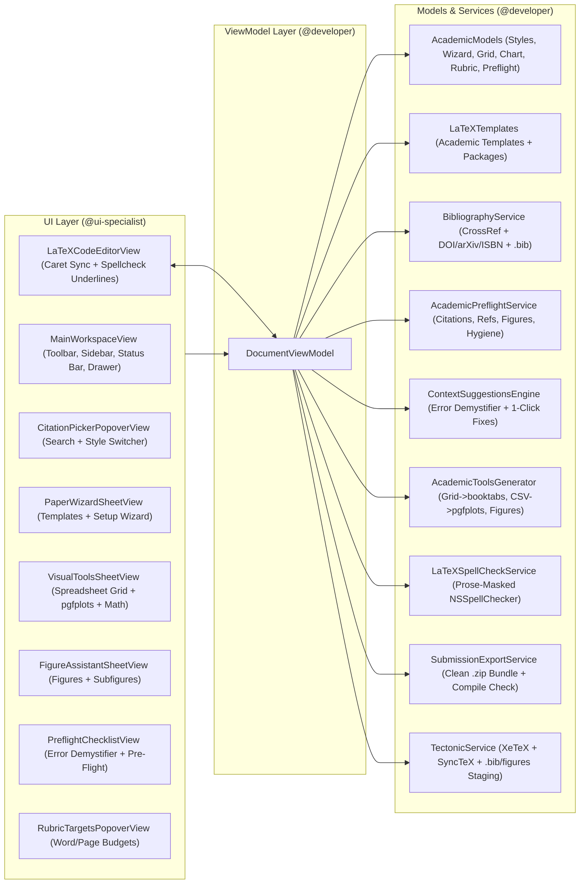
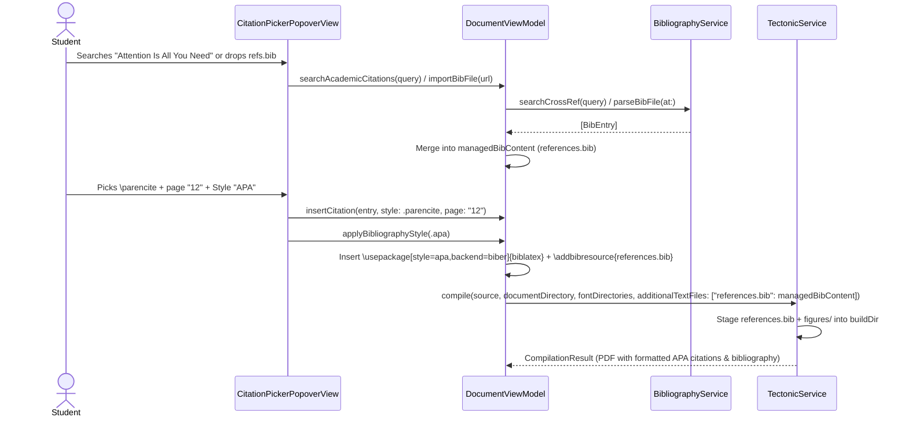
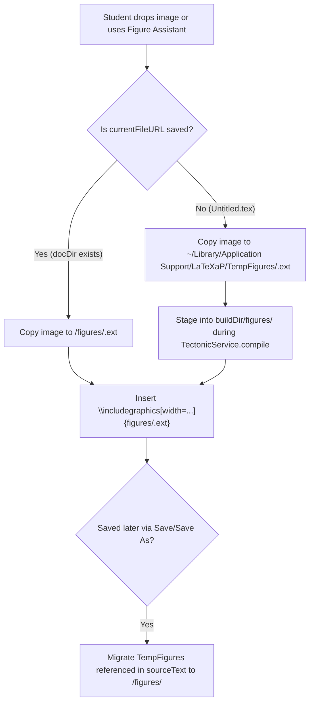
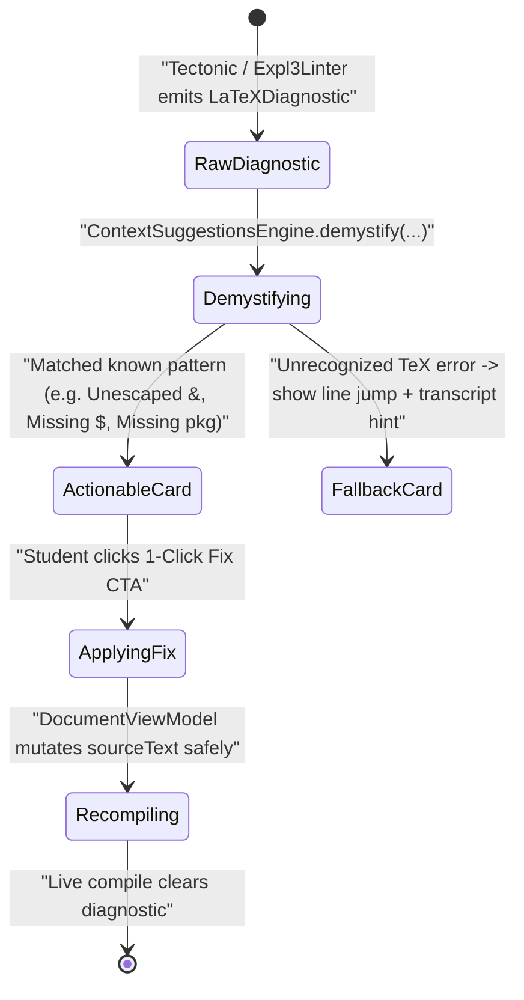

# Academic Paper Authoring Suite Architecture (`v0.2.0`) — LaTeXaP

> **Status:** Implemented (v0.2.0)  
> **Target Codebase:** `/Users/james/code/LaTeXaP` (macOS 14+, Swift 6 / SwiftUI + AppKit + Embedded Tectonic XeTeX Engine)

---

## 1. Overview & Architectural Goals

Building on LaTeXaP's existing foundation (`TectonicService`, `BibliographyService`, `OutlineParser`, `Expl3Linter`, `ContextSuggestionsEngine`, `VisualToolsSheetView`, and `v0.1.2` `FontLibraryService`), the **v0.2.0 Academic Paper Authoring Suite** turns LaTeXaP into a complete academic writing environment for students producing conference papers, journal articles, lab reports, theses, and slide decks.

### Core Capabilities Covered
1. **Smart Citation Search, `.bib` Import & Bibliography Style Switcher** (`CrossRef` keyword/title search, ISBN/DOI/arXiv lookup, drag-and-drop `.bib` import, `\cite`/`\parencite`/`\textcite` with page locators, `APA`/`IEEE`/`ACM`/`MLA`/`Chicago`/`Nature` style switcher, and `.bib` staging in `TectonicService`).
2. **Plain-English Error Demystifier, 1-Click Auto-Fix & Academic Pre-Flight Linter** (human-readable TeX error explanations, automated safe source fixes, unresolved citation/ref detection, uncited `.bib` detection, missing figure checks).
3. **Academic Starter Templates & Paper Setup Wizard** (`APA 7th`, `IEEEtran`, `acmart`, `MLA`, `STEM Lab Report`, `University Thesis`, `Beamer Slides`, plus Title/Author/Institution/Course/Double-Spacing/Anonymized Blind Review with `lineno`).
4. **Interactive Spreadsheet Table Editor, `pgfplots` Chart Generator & Relative Figure Assistant** (2D editable table grid -> `booktabs`, CSV -> `pgfplots` line/bar/scatter charts, relative `figures/` asset copy + single/subfigure layout builder, and exact-caret text insertion).
5. **Word & Page Budget Tracker, LaTeX-Aware Prose Spellcheck & Submission `.zip` Export** (abstract/prose-only/reference counts + rubric target limits, prose-masked `NSSpellChecker`, Student Mode hiding `expl3` noise, and clean `.zip` submission bundle export).

---

## 2. System Module Architecture



---

## 3. Data Models & Frozen Contracts (`@developer`)

All new domain types live in **`Sources/LaTeXaP/Models/AcademicModels.swift`** (owned by `@developer`).

### 3.1 Bibliography, Citations & Style Models

```swift
public enum CitationCommandStyle: String, Codable, CaseIterable, Identifiable, Sendable {
    case cite       // \cite{key}
    case parencite  // \parencite{key}
    case textcite   // \textcite{key}
    case autocite   // \autocite{key}
    case footcite   // \footcite{key}

    public var id: String { rawValue }
    public var command: String { "\\\(rawValue)" }
    public var displayName: String { ... }

    public func format(key: String, pageLocator: String? = nil) -> String
}

public enum BibliographyStylePreset: String, Codable, CaseIterable, Identifiable, Sendable {
    case apa      // biblatex style=apa
    case ieee     // biblatex style=ieee
    case acm      // biblatex style=acm
    case mla      // biblatex style=mla
    case chicago  // biblatex style=chicago-authordate (or authoryear fallback)
    case nature   // biblatex style=nature

    public var id: String { rawValue }
    public var displayName: String { ... }
    public var biblatexStyleOption: String { ... }
    public var description: String { ... }
}
```

### 3.2 Paper Setup Wizard & Rubric Budget Models

```swift
public enum AcademicPaperSize: String, Codable, CaseIterable, Identifiable, Sendable {
    case letterpaper
    case a4paper
    public var id: String { rawValue }
    public var displayName: String { ... }
}

public struct PaperSetupConfig: Equatable, Sendable {
    public var templateId: String
    public var title: String
    public var author: String
    public var institution: String
    public var courseOrVenue: String
    public var paperSize: AcademicPaperSize
    public var baseFontSizePt: Int           // 10, 11, 12
    public var doubleSpacing: Bool           // \usepackage{setspace} + \doublespacing
    public var anonymizedBlindReview: Bool   // Anonymizes author + \usepackage{lineno}\linenumbers
    public var bibliographyStyle: BibliographyStylePreset
}

public struct RubricTargetConfig: Codable, Equatable, Sendable {
    public var targetProseWords: Int?        // e.g. 2500
    public var maxPageCount: Int?            // e.g. 8
    public var maxAbstractWords: Int?        // e.g. 250
    public var studentModeHideExpl3: Bool    // Hides expl3-specific lint/counters in UI
}

public struct AcademicDocumentStats: Equatable, Sendable {
    public var proseWordCount: Int           // Body words excluding preamble, tables, math, bib
    public var abstractWordCount: Int        // Words inside \begin{abstract}...\end{abstract}
    public var referenceCount: Int           // Bib entries + \bibitem count
    public var figureCount: Int              // \includegraphics count
    public var tableCount: Int               // \begin{tabular|table} count
    public var pageCount: Int                // Actual rendered PDF page count (or 0 before compile)
    public var estimatedReadingMinutes: Int
}
```

### 3.3 Error Demystifier & Academic Pre-Flight Models

```swift
public enum AcademicFixOperation: Equatable, Sendable {
    case replaceLine(lineNumber: Int, originalSubstring: String, replacement: String)
    case insertPackage(packageName: String, options: String)
    case wrapLineInMath(lineNumber: Int)
    case appendMissingBrace(lineNumber: Int)
    case insertRawSnippet(snippet: String)
}

public struct DemystifiedDiagnostic: Identifiable, Equatable, Sendable {
    public let id: String
    public let line: Int?
    public let severity: DiagnosticSeverity
    public let shortTitle: String            // Plain-English title
    public let explanation: String           // Student-friendly explanation of root cause
    public let rawMessage: String            // Original TeX/Tectonic message
    public let fixButtonTitle: String?       // e.g. "Escape & to \\&"
    public let fixOperation: AcademicFixOperation?
}

public enum PreflightSeverity: String, Codable, Sendable {
    case pass
    case warning
    case blocker
}

public struct AcademicPreflightItem: Identifiable, Equatable, Sendable {
    public let id: String
    public let category: String              // "Citations", "Cross-Refs", "Figures", "Hygiene", "Budget"
    public let severity: PreflightSeverity
    public let title: String
    public let detail: String
    public let line: Int?
    public let fixButtonTitle: String?
    public let fixOperation: AcademicFixOperation?
}

public struct AcademicPreflightReport: Equatable, Sendable {
    public let items: [AcademicPreflightItem]
    public let unresolvedCitations: [String]
    public let unresolvedReferences: [String]
    public let uncitedBibKeys: [String]
    public let missingFigurePaths: [String]
    public let isSubmissionReady: Bool
}
```

### 3.4 Visual Spreadsheet Table, `pgfplots` Chart & Figure Models

```swift
public enum TableColumnAlignment: String, Codable, CaseIterable, Sendable {
    case left = "l"
    case center = "c"
    case right = "r"
}

public struct TableGridData: Equatable, Sendable {
    public var headers: [String]
    public var rows: [[String]]
    public var alignments: [TableColumnAlignment]
    public var boldHeader: Bool
    public var caption: String
    public var label: String
}

public enum PGFPlotChartType: String, Codable, CaseIterable, Identifiable, Sendable {
    case line
    case bar
    case scatter
    public var id: String { rawValue }
    public var displayName: String { ... }
}

public struct PGFPlotChartConfig: Equatable, Sendable {
    public var chartType: PGFPlotChartType
    public var title: String
    public var xLabel: String
    public var yLabel: String
    public var csvText: String
    public var showGrid: Bool
    public var showLegend: Bool
    public var caption: String
    public var label: String
}

public struct FigureInsertConfig: Equatable, Sendable {
    public var primaryRelativePath: String   // e.g. "figures/plot.png"
    public var secondaryRelativePath: String?
    public var widthFraction: Double         // 0.25 ... 1.0
    public var placement: String             // "htbp", "t", "b", "H"
    public var caption: String
    public var label: String
    public var primarySubcaption: String
    public var secondarySubcaption: String
}
```

### 3.5 Caret-Accurate Insertion & Spellcheck Models

```swift
public struct EditorInsertionRequest: Equatable, Sendable {
    public let id: UUID
    public let text: String
    public let cursorBacktrackOffset: Int    // Optional caret offset inside inserted text
}

public struct SpellingIssue: Identifiable, Equatable, Sendable {
    public let id: String
    public let word: String
    public let line: Int
    public let nsRange: NSRange              // UTF-16 range in full sourceText
    public let suggestions: [String]
}

public struct SubmissionExportResult: Equatable, Sendable {
    public let zipURL: URL
    public let includedFiles: [String]
    public let preflightWarnings: [String]
    public let compiledCleanly: Bool
}
```

---

## 4. Key Service Pipelines & Flows

### 4.1 Citation Search, `.bib` Staging & `TectonicService`



**Important `TectonicService` Staging Rules**:
- Add `additionalTextFiles: [String: String] = [:]` and `assetSearchDirectories: [URL] = []` to `TectonicService.compile(...)`.
- Stage `references.bib` (and any `figures/` directory from unsaved-document staging or `documentDirectory`) into `buildDir` so Tectonic (`XeTeX + biber/bibtex`) resolves `\addbibresource{references.bib}` and `\includegraphics{figures/foo.png}` identically whether the `.tex` file is saved on disk or still `Untitled.tex`.
- Security: validate relative filenames in `additionalTextFiles` (no `..`, no `/`, `.bib`/`.sty`/`.cls`/`.tex` leaf names only) and symlink only regular non-symlink image files into `buildDir/figures/`.

### 4.2 Relative Figure Asset Flow



### 4.3 Plain-English Error Demystifier & 1-Click Fix State Machine



### 4.4 LaTeX-Aware Prose Spellcheck (`LaTeXSpellCheckService`)

`LaTeXSpellCheckService.scan(source: String) -> [SpellingIssue]`:
1. Computes masked character intervals to **exclude**:
   - Preamble (`0 ..< \begin{document}`)
   - Comments (`(?<!\\)%.*$`)
   - `\ExplSyntaxOn ... \ExplSyntaxOff` regions
   - Verbatim/code/math environments (`equation`, `align`, `gather`, `multline`, `lstlisting`, `minted`, `verbatim`, `tikzpicture`, `pycode`)
   - Inline/display math (`$...$`, `$$...$$`, `\[...\]`, `\(...\)`)
   - LaTeX commands (`\\[a-zA-Z@]+(?:\*)?`) and structural brace arguments (`\cite{...}`, `\parencite{...}`, `\textcite{...}`, `\ref{...}`, `\eqref{...}`, `\cref{...}`, `\label{...}`, `\usepackage{...}`, `\includegraphics{...}`, `\setmainfont{...}`, `\begin{...}`, `\end{...}`)
2. Runs `NSSpellChecker.shared.checkSpelling(of: ..., startingAt: 0)` only on unmasked prose spans, mapping hits back to full-document `NSRange` and 1-based `line` numbers, plus top 4 `guesses(forWordRange:...)`.
3. `DocumentViewModel.applySpellingSuggestion(_ issue: SpellingIssue, replacement: String)` validates `nsRange` bounds and replaces safely.

---

## 5. Frozen `DocumentViewModel` API Contract for `@ui-specialist`

`@ui-specialist` binds ONLY to these public properties and methods on `DocumentViewModel` (implemented by `@developer` in `Sources/LaTeXaP/ViewModels/DocumentViewModel.swift`):

```swift
// MARK: - Academic Citations & Bibliography State
@Published public var managedBibContent: String                 // Content of references.bib (loaded/synced)
@Published public var bibSearchResults: [BibEntry]
@Published public var isSearchingCrossRef: Bool
@Published public var selectedCitationStyle: CitationCommandStyle
@Published public var selectedBibliographyStyle: BibliographyStylePreset
@Published public var showCitationPickerPopover: Bool

// MARK: - Academic Templates & Paper Wizard State
@Published public var showPaperWizardSheet: Bool
@Published public var isBlindReviewEnabled: Bool
@Published public var isDoubleSpacedEnabled: Bool

// MARK: - Academic Stats, Rubric Targets & Student Mode
@Published public var academicStats: AcademicDocumentStats
@Published public var rubricTargets: RubricTargetConfig         // Persisted in UserDefaults
@Published public var preflightReport: AcademicPreflightReport
@Published public var demystifiedDiagnostics: [DemystifiedDiagnostic]

// MARK: - Spellcheck & Cursor-Accurate Insertion
@Published public var proseSpellCheckEnabled: Bool              // Persisted in UserDefaults
@Published public var spellingIssues: [SpellingIssue]
@Published public var pendingEditorInsertion: EditorInsertionRequest?
@Published public var showFigureAssistantSheet: Bool
@Published public var pendingDroppedFigureURL: URL?

// MARK: - Spreadsheet Table & PGFPlots Chart State (VisualToolsSheetView)
@Published public var tableGridData: TableGridData
@Published public var chartConfig: PGFPlotChartConfig

// MARK: - Submission Export State
@Published public var isExportingSubmissionBundle: Bool
@Published public var submissionExportMessage: String?

// MARK: - Public Actions
public func searchCrossRefCitations()                           // Uses bibLookupQuery
public func importBibEntry(_ entry: BibEntry, intoBibFile: Bool = true)
public func importBibFileViaPanel()
public func handleDroppedBibFileURL(_ url: URL)
public func insertFormattedCitation(_ entry: BibEntry, style: CitationCommandStyle, pageLocator: String?)
public func applyBibliographyStyle(_ style: BibliographyStylePreset)

public func applyPaperSetupWizard(_ config: PaperSetupConfig)
public func toggleBlindReview(_ enabled: Bool)
public func toggleDoubleSpacing(_ enabled: Bool)
public func updateRubricTargets(_ targets: RubricTargetConfig)

public func applyAcademicFix(_ op: AcademicFixOperation)
public func applySpellingSuggestion(_ issue: SpellingIssue, replacement: String)
public func ignoreSpellingWord(_ word: String)

public func insertTextAtCaret(_ text: String, backtrackOffset: Int = 0)
public func insertFigureWithConfig(sourceURL: URL, secondaryURL: URL?, config: FigureInsertConfig)
public func insertSpreadsheetTable()
public func insertPGFPlotChart()

public func exportSubmissionBundle(stripComments: Bool = false, anonymize: Bool = false)
```

### Caret Insertion Handshake (`LaTeXCodeEditorView` <-> `DocumentViewModel`)
- `@ui-specialist` updates `LaTeXCodeEditorView` to accept `@Binding public var pendingInsertion: EditorInsertionRequest? = nil` and `public var spellingIssues: [SpellingIssue] = []` and `public var spellCheckEnabled: Bool = false` (all with default parameter values so existing initializers stay source-compatible).
- When `pendingInsertion` is non-nil, `LaTeXCodeEditorView.updateNSView` inserts `request.text` at `textView.selectedRange()` via `textView.shouldChangeText(in:replacementString:)` + `textStorage.replaceCharacters(...)` (preserving undo!), repositions the caret by `request.cursorBacktrackOffset`, and resets `pendingInsertion = nil`.

---

## 6. Strict Non-Overlapping File Ownership Split (Phase 2)

Neither engineer may edit files owned by the other.

| Owner | Action | File Path | Scope & Responsibility |
| :--- | :--- | :--- | :--- |
| **`@developer`** | Create | `Sources/LaTeXaP/Models/AcademicModels.swift` | All academic enums/structs (`CitationCommandStyle`, `BibliographyStylePreset`, `PaperSetupConfig`, `RubricTargetConfig`, `AcademicDocumentStats`, `DemystifiedDiagnostic`, `AcademicFixOperation`, `AcademicPreflightReport`, `TableGridData`, `PGFPlotChartConfig`, `FigureInsertConfig`, `SpellingIssue`, `EditorInsertionRequest`, `SubmissionExportResult`) |
| **`@developer`** | Create | `Sources/LaTeXaP/Services/AcademicPreflightService.swift` | Unresolved `\cite`/`\ref`, uncited bib entries, missing figure paths, typography hygiene checks |
| **`@developer`** | Create | `Sources/LaTeXaP/Services/AcademicToolsGenerator.swift` | 2D `TableGridData` <-> CSV & `booktabs` LaTeX, CSV -> `pgfplots` LaTeX, single/subfigure `subcaption` LaTeX |
| **`@developer`** | Create | `Sources/LaTeXaP/Services/LaTeXSpellCheckService.swift` | Prose-masked macOS `NSSpellChecker` scanning & ignore-word support |
| **`@developer`** | Create | `Sources/LaTeXaP/Services/SubmissionExportService.swift` | Collect `.tex`, `\input` files, `.bib`, relative `figures/`, custom fonts, verify build & package clean `.zip` via `/usr/bin/ditto` |
| **`@developer`** | Edit | `Sources/LaTeXaP/Models/LaTeXTemplates.swift` | Add 7 academic templates (`apa7-student`, `ieee-conference`, `acm-article`, `mla-essay`, `stem-lab-report`, `university-thesis`, `beamer-slides`) + `biblatex`, `natbib`, `pgfplots`, `subcaption`, `setspace`, `lineno`, `apa7`, `IEEEtran`, `acmart`, `mhchem` packages |
| **`@developer`** | Edit | `Sources/LaTeXaP/Services/BibliographyService.swift` | CrossRef keyword search API, ISBN/URL lookup, `.bib` parser & BibTeX formatter, citation key deduplication |
| **`@developer`** | Edit | `Sources/LaTeXaP/Services/TectonicService.swift` | Stage `additionalTextFiles` (`.bib`) and `TempFigures` into `buildDir` with path-traversal/symlink safety |
| **`@developer`** | Edit | `Sources/LaTeXaP/Services/ContextSuggestionsEngine.swift` | `demystify(diagnostics:source:)` mapping top TeX errors to plain-English explanations & `AcademicFixOperation` |
| **`@developer`** | Edit | `Sources/LaTeXaP/Services/Expl3Linter.swift` | Add `computeAcademicStatistics(source:bibEntries:pageCount:)` for prose-only, abstract, figure, and table counts |
| **`@developer`** | Edit | `Sources/LaTeXaP/Services/LaTeXAutoComplete.swift` | Support `\parencite`, `\textcite`, `\autocite`, `\footcite`, `pgfplots` / `subcaption` / `siunitx` snippets |
| **`@developer`** | Edit | `Sources/LaTeXaP/ViewModels/DocumentViewModel.swift` | Implement full academic `@Published` properties, `UserDefaults` persistence, wizard/fix/citation/figure/export methods |
| **`@developer`** | Edit | `Tests/LaTeXaPTests/LaTeXaPTests.swift` | Unit & integration tests for all academic services, generators, preflight checks, spellcheck masking, `.bib` staging, and `.zip` export |
| **`@ui-specialist`** | Create | `Sources/LaTeXaP/Views/PaperWizardSheetView.swift` | Academic Template Gallery + Paper Setup Wizard UI (Title, Author, Institution, Course, Double-Spacing, Blind Review, Citation Style) |
| **`@ui-specialist`** | Create | `Sources/LaTeXaP/Views/RubricTargetsPopoverView.swift` | Status-bar word/abstract/page budget popover + Student Mode (`studentModeHideExpl3`) toggle |
| **`@ui-specialist`** | Create | `Sources/LaTeXaP/Views/CitationPickerPopoverView.swift` | Smart CrossRef/DOI/arXiv search + `.bib` import + citation style & page locator quick-picker (`⇧⌘K`) |
| **`@ui-specialist`** | Create | `Sources/LaTeXaP/Views/FigureAssistantSheetView.swift` | Relative figure/subfigure layout builder with image preview, width slider, placement picker, caption/label |
| **`@ui-specialist`** | Create | `Sources/LaTeXaP/Views/PreflightChecklistView.swift` | Plain-English Error Demystifier cards with 1-click fix buttons + Academic Pre-Flight submission checklist |
| **`@ui-specialist`** | Edit | `Sources/LaTeXaP/Views/VisualToolsSheetView.swift` | Interactive 2D Spreadsheet Table Grid mode, `pgfplots` Chart Builder tab, equation templates & caret-accurate insertion |
| **`@ui-specialist`** | Edit | `Sources/LaTeXaP/Views/MainWorkspaceView.swift` | Wire upgraded BibTeX tab (style switcher, `.bib` dropzone, CrossRef search), Templates Wizard button, StatusBar Rubric pill, DiagnosticsDrawerView Pre-Flight tab, Editor header Spellcheck toggle, and Export Submission `.zip` |
| **`@ui-specialist`** | Edit | `Sources/LaTeXaP/Views/LaTeXCodeEditorView.swift` | Implement `pendingInsertion` caret-accurate insertion, prose-only spellcheck underlines/context menu suggestions, and `.bib` file drop support |
| **`@ui-specialist`** | Edit | `Sources/LaTeXaP/LaTeXaPApp.swift` | Add menu items & shortcuts: Paper Setup Wizard (`⇧⌘N`), Quick Citation Picker (`⇧⌘K`), Export Submission Bundle (`.zip`), Toggle Prose Spellcheck, Student Mode |
