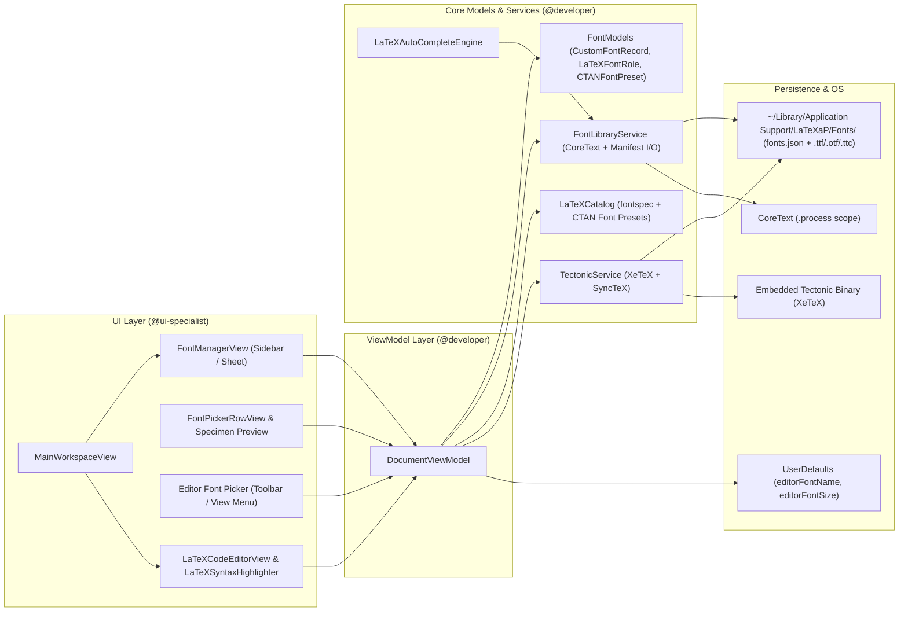
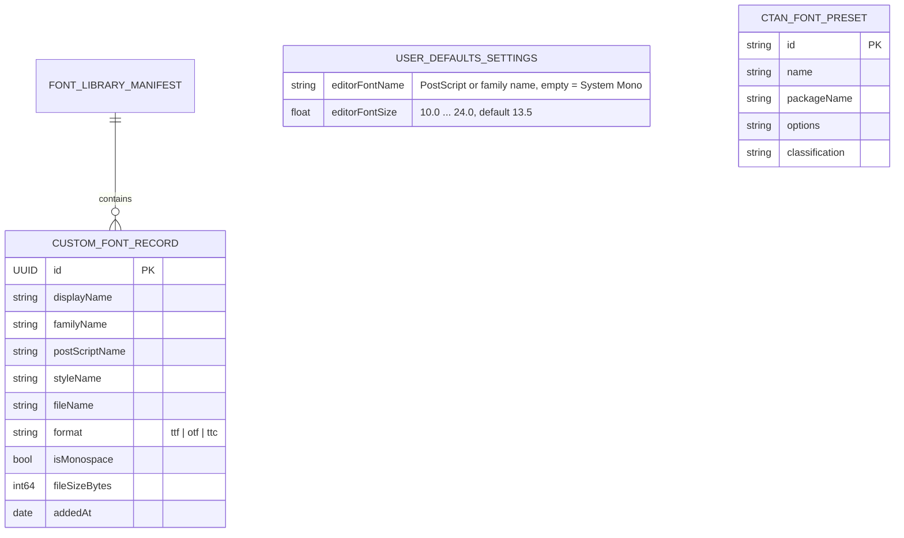
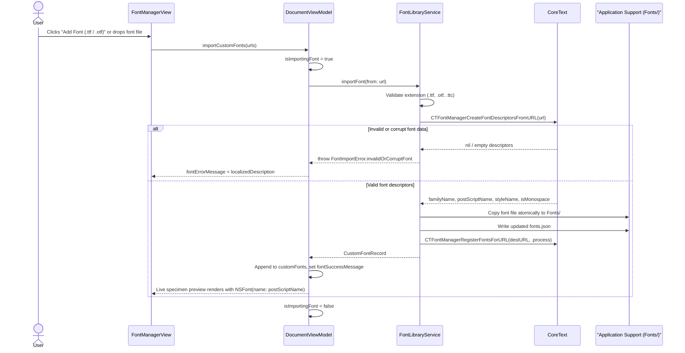
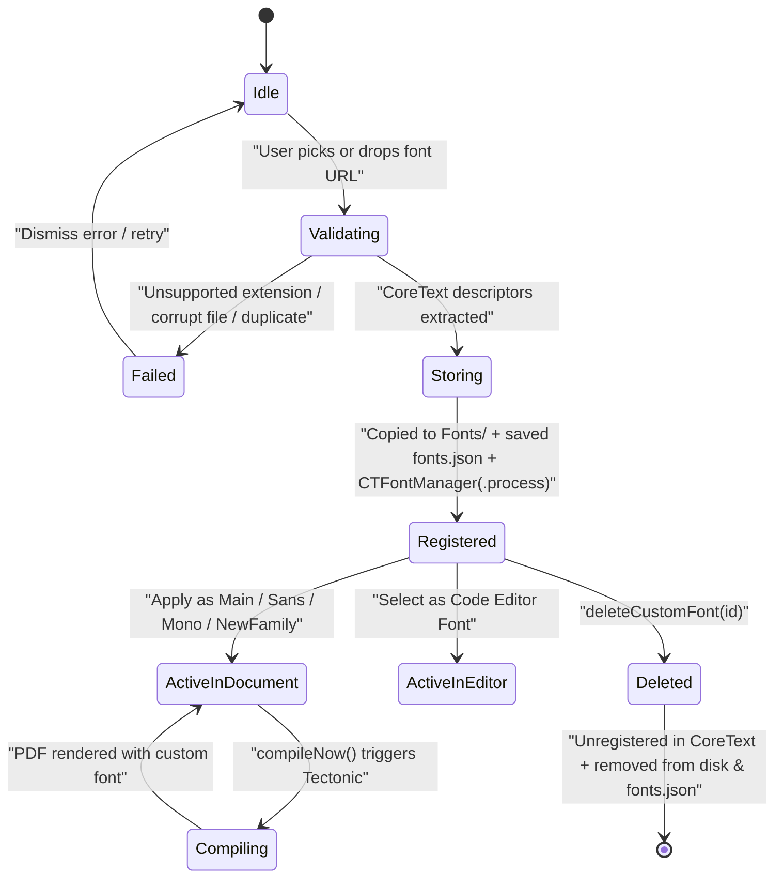

# Custom Fonts Architecture Specification — LaTeXaP

> **Status:** Implemented (v0.1.2)  
> **Target Codebase:** `/Users/james/code/LaTeXaP` (Native macOS Swift 6 / SwiftUI + AppKit + Embedded Tectonic XeTeX Engine, macOS 14+)

---

## 1. Current Codebase Analysis

An inspection of `/Users/james/code/LaTeXaP` shows how fonts, templates, LaTeX compilation, and UI settings are currently structured:

| Subsystem | Current File(s) | Current Behavior & Gaps |
| :--- | :--- | :--- |
| **Code Editor Typography** | [LaTeXCodeEditorView.swift](../Sources/LaTeXaP/Views/LaTeXCodeEditorView.swift) | `LaTeXSyntaxHighlighter.highlight(...)` hardcodes `NSFont.monospacedSystemFont(ofSize: fontSize, weight: .regular/.semibold)`. `LaTeXEditorTextView.draw(_:)` also hardcodes `13.5` pt `monospacedSystemFont` for inline ghost completions. No custom font family selection exists. |
| **Document / Typesetting Fonts** | [LaTeXTemplates.swift](../Sources/LaTeXaP/Models/LaTeXTemplates.swift) | `LaTeXCatalog.commonPackages` has no `fontspec` entry and no CTAN font presets (e.g. `libertinus`, `ebgaramond`, `fira`, `plex`). Templates rely on default Computer Modern. |
| **LaTeX Compiler** | [TectonicService.swift](../Sources/LaTeXaP/Services/TectonicService.swift) | `TectonicService` runs the embedded `tectonic` binary (`XeTeX + LaTeX3 + SyncTeX`) inside `NSTemporaryDirectory()/LaTeXaPStudioBuild`. Because Tectonic runs XeTeX, it natively supports `.otf`/`.ttf`/`.ttc` fonts via `fontspec`, but `TectonicService` currently passes no custom font search directories (`OPENTYPEFONTS`, `TTFONTS`, `OSFONTDIR`, `TEXINPUTS`) and stages no imported font files in `workspaceDir`. |
| **State & Persistence** | [DocumentViewModel.swift](../Sources/LaTeXaP/ViewModels/DocumentViewModel.swift) | Stores transient `@Published public var editorFontSize: CGFloat = 13.5` in memory only (no `UserDefaults` persistence across launches, no custom font library state, no font import/delete/apply actions). |
| **Autocomplete & Suggestions** | [LaTeXAutoComplete.swift](../Sources/LaTeXaP/Services/LaTeXAutoComplete.swift), [ContextSuggestionsEngine.swift](../Sources/LaTeXaP/Services/ContextSuggestionsEngine.swift) | No autocomplete for `fontspec` commands (`\setmainfont`, `\setsansfont`, `\setmonofont`, `\newfontfamily`) or brace-argument completion for user-installed custom fonts. |
| **UI & Menus** | [MainWorkspaceView.swift](../Sources/LaTeXaP/Views/MainWorkspaceView.swift), [LaTeXaPApp.swift](../Sources/LaTeXaP/LaTeXaPApp.swift) | `SidebarTab` has 5 tabs (`Outline`, `Packages`, `BibTeX`, `LaTeX3`, `Templates`). `View` menu only supports `Increase/Decrease Editor Font Size`. There is no UI to import `.ttf`/`.otf`/`.ttc` files, preview fonts, or assign fonts to the document or editor. |

---

## 2. Goals & Design Principles

1. **Dual-Target Font Support (Document Typesetting + Editor Appearance)**:
   - **Document Fonts (PDF output via Tectonic/XeTeX)**: Import local `.ttf`, `.otf`, and `.ttc` files, browse macOS system fonts, and insert CTAN font packages (`fontspec`, `libertinus`, `ebgaramond`, `fira`, `plex`, etc.).
   - **Editor Fonts (Source Code `NSTextView`)**: Select any imported monospaced font or macOS monospaced system font as the code editor typeface, persisted across launches.
2. **Non-Invasive Sandboxed Storage**:
   - Store user-imported font files inside `~/Library/Application Support/LaTeXaP/Fonts/` with an atomic JSON manifest (`fonts.json`). Never mutate `~/Library/Fonts` or system directories.
3. **In-Process Preview Without System Side Effects**:
   - Register imported fonts using `CoreText` (`CTFontManagerRegisterFontsForURL(..., .process, nil)`) so SwiftUI and `NSFont` render live font specimens inside the app without polluting macOS Font Book.
4. **Deterministic Tectonic / XeTeX Resolution**:
   - Symlink verified regular managed font files into `TectonicService`'s `workspaceDir` (`document.tex`'s build directory) **and** append validated managed font directories to `OPENTYPEFONTS`, `TTFONTS`, and `OSFONTDIR` in `Process.environment`. This allows clean `\setmainfont{MyFont-Regular.ttf}` statements without brittle hardcoded absolute paths in `.tex` source files.
5. **Clean Parallel Implementation Boundary**:
   - Strict non-overlapping file ownership between `@developer` and `@ui-specialist`, connected via a frozen Swift API contract on `FontModels`, `FontLibraryService`, and `DocumentViewModel`.

---

## 3. High-Level Architecture & Module Boundaries



---

## 4. Data Models & Persistence Schema

All new font domain types live in **`Sources/LaTeXaP/Models/FontModels.swift`** (owned by `@developer`).

### 4.1 Core Types

```swift
public enum FontFileFormat: String, Codable, Sendable, CaseIterable {
    case ttf
    case otf
    case ttc

    public static func from(url: URL) -> FontFileFormat?
    public var fontspecExtension: String // ".ttf", ".otf", ".ttc"
    public var displayBadge: String      // "TTF", "OTF", "TTC"
}

public enum LaTeXFontRole: String, Codable, Sendable, CaseIterable, Identifiable {
    case main         // \setmainfont{...}
    case sans         // \setsansfont{...}
    case mono         // \setmonofont{...}
    case customFamily // \newfontfamily\<cmd>{...}

    public var id: String { rawValue }
    public var displayName: String
    public var latexCommand: String // "\\setmainfont", "\\setsansfont", "\\setmonofont", "\\newfontfamily"
}

public struct CustomFontRecord: Codable, Identifiable, Equatable, Sendable {
    public let id: UUID
    public var displayName: String
    public let familyName: String
    public let postScriptName: String
    public let styleName: String
    public let fileName: String          // Stored filename inside managed Fonts/ dir
    public let format: FontFileFormat
    public let isMonospace: Bool
    public let fileSizeBytes: Int64
    public let addedAt: Date
}

public struct FontLibraryManifest: Codable, Equatable, Sendable {
    public var schemaVersion: Int = 1
    public var fonts: [CustomFontRecord]
}

public struct CTANFontPreset: Identifiable, Equatable, Sendable {
    public let id: String
    public let name: String
    public let packageName: String
    public let options: String
    public let classification: String // "Serif", "Sans-Serif", "Monospace", "Math + Serif"
    public let description: String
    public let usepackageStatement: String
}

public enum FontImportError: LocalizedError, Equatable, Sendable {
    case unsupportedFormat(String)
    case fileNotFound(String)
    case invalidOrCorruptFont(String)
    case duplicateFont(String)
    case storageFailure(String)
}
```

### 4.2 Entity-Relationship Diagram



### 4.3 Storage & Persistence Layout

1. **Managed Font Files & Manifest**:
   - Base directory: `FileManager.default.urls(for: .applicationSupportDirectory, in: .userDomainMask).first! / "LaTeXaP" / "Fonts"`
   - Index file: `fonts.json` (pretty-printed UTF-8 JSON encoding `FontLibraryManifest`, written atomically).
   - Font binary copies: `<FontsDir>/<sanitized-filename>.<ext>` (e.g. `JetBrainsMono-Regular.ttf`).
   - Collision strategy:
     - Before copying, compute SHA-256 (or compare `postScriptName` + `fileSizeBytes`) to detect exact duplicates (`FontImportError.duplicateFont`).
     - If a different font shares the same filename, append a short suffix (`-<8charUUID>.<ext>`) so existing stored fonts are never overwritten.
2. **Editor Font Preferences (`UserDefaults`)**:
   - Keys:
     - `"LaTeXaP.editorFontName"` (`String`, default `""` -> `NSFont.monospacedSystemFont`)
     - `"LaTeXaP.editorFontSize"` (`Double`, clamped `10.0...24.0`, default `13.5`)
   - Hydrated in `DocumentViewModel.init(...)` and persisted immediately on change.

---

## 5. Font Import, Preview & LaTeX Compilation Flows

### 5.1 Font Import & Validation Sequence



### 5.2 Font Lifecycle State Machine



### 5.3 Tectonic / XeTeX Compilation Integration

In `TectonicService.compile(source:documentDirectory:fontDirectories:)` (with `fontDirectories: [URL] = []` default so existing callers remain source-compatible):

1. **Symlink / Stage Managed Font Files into `workspaceDir` (`buildDir`)**:
   - Before invoking `tectonic`, `TectonicService` scans `fontDirectories` for regular (non-symlink) `.ttf`, `.otf`, `.ttc` files and creates symbolic links inside `buildDir` (cleaning up any dangling symlinks from deleted fonts).
   - Because `texFileURL` is `<buildDir>/document.tex`, Tectonic's `FilesystemPrimaryInput` always resolves `\setmainfont{MyFont-Regular.ttf}` immediately—even when `documentDirectory` points elsewhere (e.g., an open `.tex` file on Desktop).
2. **Environment Injection & Security Hardening**:
   - Validate each directory in `fontDirectories` (`isFileURL`, no `:`, `\r`, `\n`, or `\0`) and prepend to `OPENTYPEFONTS`, `TTFONTS`, and `OSFONTDIR` on `process.environment` (without `TEXINPUTS` or `//` recursive wildcards).
   - `FontLibraryService` enforces regular-file validation, rejects symlinks, caps imports at `64 MB`, validates `fonts.json` filenames against path traversal, and sanitizes TeX arguments/command names (`sanitizeTeXArgument`, `sanitizeCustomCommandName`) prior to preamble insertion.
3. **Generated LaTeX Preamble Statements**:
   - When `applyCustomFontToDocument(_:role:customCommand:)` is invoked on `DocumentViewModel`:
     - Ensure `\usepackage{fontspec}` is inserted in the preamble (right after `\documentclass...`) if not already present.
     - Generate clean, idiomatic `fontspec` code via `FontLibraryService.generateFontspecBlock(...)`:
       - `.main`: `\setmainfont{<fileName>}` (for custom font files) or `\setmainfont{<familyName>}` (for macOS system fonts)
       - `.sans`: `\setsansfont{<fileName>}`
       - `.mono`: `\setmonofont{<fileName>}`
       - `.customFamily`: `\newfontfamily\<cmd>{<fileName>}` (sanitizing `<cmd>` to valid TeX letters)
     - If an existing `\setmainfont{...}` / `\setsansfont{...}` / `\setmonofont{...}` exists in the preamble (before `\begin{document}`), replace that single declaration cleanly rather than creating conflicting duplicate declarations.
   - Trigger `compileNow()` (or allow `sourceText`'s existing debounced compile when `autoCompileEnabled == true`; `applyCustomFontToDocument` can rely on `didSet` or trigger `Task { await compileNow() }` explicitly for instant feedback).

---

## 6. Frozen API Contracts Between `@developer` and `@ui-specialist`

Both Phase 2 engineers MUST build against these exact public interfaces without modifying each other's files.

### 6.1 `FontLibraryService` (`Sources/LaTeXaP/Services/FontLibraryService.swift`)

```swift
public final class FontLibraryService: Sendable {
    public let fontsDirectory: URL
    public let manifestURL: URL

    public init(storageDirectory: URL? = nil)

    public func loadManifest() throws -> [CustomFontRecord]
    public func importFont(from sourceURL: URL, displayName: String? = nil) throws -> CustomFontRecord
    public func renameFont(id: UUID, newDisplayName: String) throws -> CustomFontRecord
    public func deleteFont(id: UUID) throws
    public func fontFileURL(for record: CustomFontRecord) -> URL

    @discardableResult
    public func registerInProcess(_ record: CustomFontRecord) -> Bool
    public func unregisterInProcess(_ record: CustomFontRecord)
    public func registerAllStoredFonts() -> [CustomFontRecord]

    public func systemFontFamilies(monospaceOnly: Bool) -> [String]

    public func generateFontspecBlock(
        for record: CustomFontRecord,
        role: LaTeXFontRole,
        customCommandName: String? = nil
    ) -> String

    public func generateSystemFontspecBlock(
        familyName: String,
        role: LaTeXFontRole,
        customCommandName: String? = nil
    ) -> String
}
```

### 6.2 `LaTeXCatalog` Additions (`Sources/LaTeXaP/Models/LaTeXTemplates.swift`)

- Add `"fontspec"` (category `"Layout & Typography"`) and popular CTAN font packages (`"libertinus"`, `"ebgaramond"`, `"fira"`, `"plex"`, `"lmodern"`, `"tgpagella"`) to `LaTeXCatalog.commonPackages`.
- Expose `LaTeXCatalog.ctanFontPresets: [CTANFontPreset]` for curated one-click CTAN font presets in the Fonts UI.

### 6.3 `TectonicService` Additions (`Sources/LaTeXaP/Services/TectonicService.swift`)

```swift
public func compile(
    source: String,
    documentDirectory: URL? = nil,
    fontDirectories: [URL] = []
) async -> CompilationResult
```

### 6.4 `DocumentViewModel` Contract (`Sources/LaTeXaP/ViewModels/DocumentViewModel.swift`)

`@ui-specialist` binds to and calls ONLY these public properties and methods on `DocumentViewModel`:

```swift
// Published Font State
@Published public var customFonts: [CustomFontRecord] = []
@Published public var fontSearchText: String = ""
@Published public var isImportingFont: Bool = false
@Published public var fontErrorMessage: String?
@Published public var fontSuccessMessage: String?
@Published public var showFontManagerSheet: Bool = false
@Published public var editorFontName: String = ""     // Persisted in UserDefaults; "" = System Monospaced
// Existing @Published public var editorFontSize: CGFloat (now persisted in UserDefaults)

// Computed / Query Helpers
public var availableEditorFontNames: [String]         // System monospaced + custom monospace PostScript names
public var availableSystemFontFamilies: [String]      // Sorted macOS font families

// Public Intents / Actions
public func openImportFontPanel()
public func importCustomFonts(urls: [URL])
public func deleteCustomFont(_ font: CustomFontRecord)
public func renameCustomFont(_ font: CustomFontRecord, to newName: String)
public func applyCustomFontToDocument(_ font: CustomFontRecord, role: LaTeXFontRole, customCommand: String = "\\customfont")
public func applySystemFontToDocument(familyName: String, role: LaTeXFontRole, customCommand: String = "\\customfont")
public func applyCTANFontPreset(_ preset: CTANFontPreset)
public func selectEditorFont(_ fontName: String)
public func resetEditorFontToDefault()
public func clearFontFeedback()
```

### 6.5 `LaTeXCodeEditorView` & `LaTeXSyntaxHighlighter` Signature (`@ui-specialist`)

Keep default parameter values so any existing call sites compile without changes:

```swift
// In LaTeXSyntaxHighlighter:
public func highlight(
    textStorage: NSTextStorage,
    fontSize: CGFloat = 13.5,
    fontName: String = "",
    lightBackground: Bool = true
)

// In LaTeXCodeEditorView:
public var fontSize: CGFloat
public var fontName: String // default "" in init(...)
```

---

## 7. Autocomplete & Context Suggestions Integration (`@developer`)

1. **`LaTeXAutoCompleteEngine`**:
   - Add built-in completion items for `fontspec`:
     - `\setmainfont` (`{font}`, category `"pkg"`)
     - `\setsansfont` (`{font}`, category `"pkg"`)
     - `\setmonofont` (`{font}`, category `"pkg"`)
     - `\newfontfamily` (`{\cmd}{font}`, category `"pkg"`)
   - Extend `extractQuery(in:cursorLocation:)` to recognize `\setmainfont{prefix`, `\setsansfont{prefix`, `\setmonofont{prefix`, and `\newfontfamily{\cmd}{prefix` (`enclosingCommand = "font"`).
   - Extend `suggestions(for:in:customFonts:)` (with default `customFonts: [CustomFontRecord] = []` to stay backward-compatible with existing tests) so typing inside `\setmainfont{` suggests installed `customFonts` (`fileName` + `displayName`).
2. **`ContextSuggestionsEngine`**:
   - Detect XeTeX / `fontspec` font-not-found diagnostics (`"Package fontspec Error"` or `"Font ... cannot be found"`) and surface an actionable suggestion to open/verify custom fonts or load `\usepackage{fontspec}`.

---

## 8. Non-Overlapping File Ownership Split (Phase 2)

To enable completely parallel Phase 2 implementation with **zero merge conflicts**, file ownership is strictly partitioned:

| Owner | Action | Owned File Path(s) | Responsibilities |
| :--- | :--- | :--- | :--- |
| **`@developer`** | Create | `Sources/LaTeXaP/Models/FontModels.swift` | `FontFileFormat`, `LaTeXFontRole`, `CustomFontRecord`, `FontLibraryManifest`, `CTANFontPreset`, `FontImportError` |
| **`@developer`** | Create | `Sources/LaTeXaP/Services/FontLibraryService.swift` | CoreText validation & `.process` registration, `Application Support/LaTeXaP/Fonts` storage, `fonts.json` persistence, system font discovery, `fontspec` preamble generator |
| **`@developer`** | Edit | `Sources/LaTeXaP/Models/LaTeXTemplates.swift` | Add `fontspec` & CTAN font packages to `commonPackages`; add `ctanFontPresets` |
| **`@developer`** | Edit | `Sources/LaTeXaP/Services/TectonicService.swift` | Accept `fontDirectories`, symlink managed fonts into `workspaceDir`, inject `OPENTYPEFONTS`/`TTFONTS`/`OSFONTDIR`/`TEXINPUTS` |
| **`@developer`** | Edit | `Sources/LaTeXaP/Services/LaTeXAutoComplete.swift` | Add `fontspec` command completions & brace-argument completions for custom fonts |
| **`@developer`** | Edit | `Sources/LaTeXaP/Services/ContextSuggestionsEngine.swift` | Add `fontspec` / font-error context guidance |
| **`@developer`** | Edit | `Sources/LaTeXaP/ViewModels/DocumentViewModel.swift` | Implement all font `@Published` state, `UserDefaults` editor font persistence, import/delete/rename/apply/editor-font methods, pass `fontDirectories` to `TectonicService` |
| **`@developer`** | Edit | `Tests/LaTeXaPTests/LaTeXaPTests.swift` | Unit & integration tests for font validation, manifest CRUD, CoreText registration, `fontspec` preamble rewriting, `UserDefaults` persistence, and autocomplete |
| **`@ui-specialist`** | Create | `Sources/LaTeXaP/Views/FontManagerView.swift` | Fonts management panel/sheet: drag-and-drop `.ttf`/`.otf`/`.ttc` dropzone, "Add Font..." button, search filter, Custom / System / CTAN sections, live specimen preview, role assignment (`Main`, `Sans`, `Mono`, `Custom Family`, `Editor`), rename/delete actions, empty/loading/error/success states, full macOS accessibility labels/hints/keyboard nav |
| **`@ui-specialist`** | Create | `Sources/LaTeXaP/Views/EditorFontPopoverView.swift` | Compact editor font family & size picker popover for the editor header bar |
| **`@ui-specialist`** | Edit | `Sources/LaTeXaP/Views/MainWorkspaceView.swift` | Add `"Fonts"` `SidebarTab`, toolbar `"Fonts"` button / sheet binding (`$viewModel.showFontManagerSheet`), and editor header font picker trigger |
| **`@ui-specialist`** | Edit | `Sources/LaTeXaP/Views/LaTeXCodeEditorView.swift` | Pass `viewModel.editorFontName` into `LaTeXCodeEditorView` & `LaTeXSyntaxHighlighter`; fix ghost-text font size & family to match selected editor font |
| **`@ui-specialist`** | Edit | `Sources/LaTeXaP/LaTeXaPApp.swift` | Add `"Add Custom Font..."` and `"Manage Fonts..."` items in `CommandMenu("View")` wired to `viewModel` |

> **Rule for Phase 2:** Neither engineer may edit files owned by the other. Any contract change must be proposed on the swarm board first.
