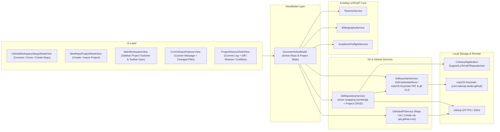
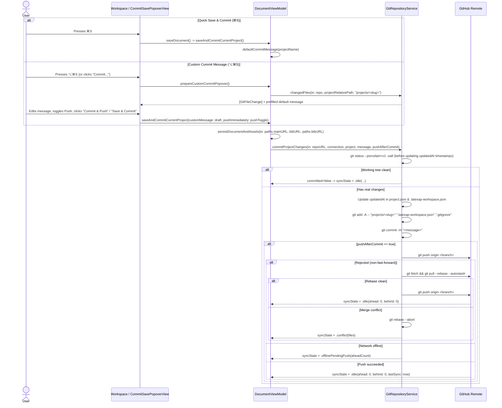
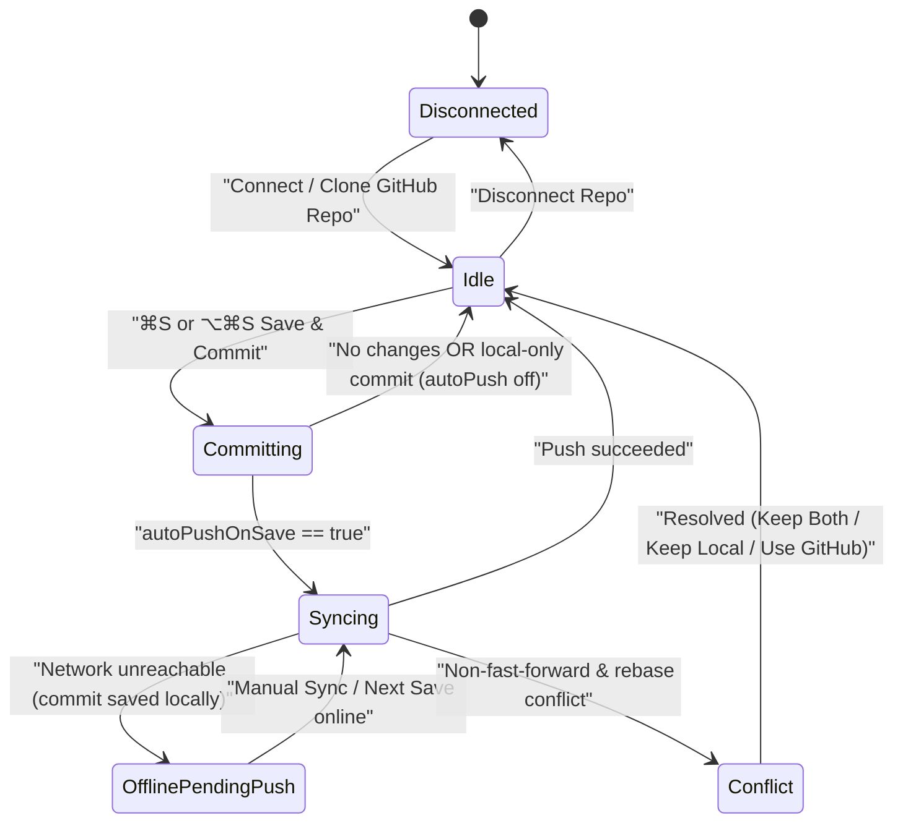

# GitHub Repository Multi-Project Storage Architecture — LaTeXaP

> **Status:** Implemented (v0.3.0)  
> **Target Codebase:** `/Users/james/code/LaTeXaP` (macOS 14+, Swift 6 / SwiftUI + AppKit + Embedded Tectonic XeTeX Engine)

---

## 1. Overview & Design Goals

Students and researchers often want their LaTeX papers, lab reports, and theses backed by a single personal or course **GitHub repository** rather than scattered local folders. This specification defines the architecture for **GitHub Multi-Project Repository Storage** in LaTeXaP:

1. **Multi-Project Repository Layout**: Store multiple independent LaTeXaP projects inside a single GitHub repository (each in `projects/<project-slug>/` with its own `main.tex`, `references.bib`, `sections/`, `figures/`, and `project.json`), coordinated by a root `.latexap-workspace.json`.
2. **Save-to-Commit Workflow**:
   - **Quick Save & Commit (`⌘S`)**: Saves modified project files locally and creates a scoped Git commit using an automatic default message:  
     `Update <Project Name> — YYYY-MM-DD HH:mm` (e.g., `Update CS229 Final Paper — 2026-11-17 14:20`), optionally pushing to GitHub in the background.
   - **Save & Commit with Message... (`⌥⌘S`)**: Opens a commit popover/sheet pre-populated with the default timestamped message so the user can customize the commit message, review changed files, and choose whether to push immediately.
3. **Seamless Integration with Existing v0.2.0 Workflows**:
   - Works transparently with `DocumentViewModel`'s `currentFileURL`, `managedBibContent` (`references.bib`), `figures/` asset migration, `SubmissionExportService`, and `TectonicService` local compilation.
   - Uses macOS Keychain for token security and `/usr/bin/git` inside a Swift `actor` for non-blocking, offline-capable operations.

---

## 2. Backend Strategy Comparison & Recommendation

| Criterion | Option A: Managed Local Git Clone (`/usr/bin/git`) + GitHub Discovery API **(Recommended)** | Option B: Direct GitHub Contents / Git Trees REST API |
| :--- | :--- | :--- |
| **Offline & Instant `⌘S` Saves** | **Instant local write + `git commit` offline**; background `git push` syncs when online. | Fails offline; every `⌘S` blocks on multi-step HTTPS round-trips. |
| **Multi-File Atomic Commits** | Single `git commit` atomically snapshots `main.tex`, `references.bib`, `figures/*.png`, and `project.json`. | Contents API updates 1 file per commit; Git Trees API requires N+1 blob uploads + tree/commit creation per save. |
| **Tectonic Compilation** | Local clone provides a real `documentDirectory` for `\input{sections/...}`, `references.bib`, and `figures/...`. | Requires maintaining a separate local mirror directory anyway. |
| **Commit History & Restore** | `git log -- projects/<slug>` and `git show <sha>:...` work locally with zero rate-limit penalty. | Counts against GitHub API rate limits on every history browse. |
| **Conflict Handling** | Standard 3-way Git fetch/rebase; multi-project isolation minimizes cross-project conflicts. | Manual SHA conflict resolution per file; brittle for binary images. |

**Recommendation:** Adopt **Option A (Managed Local Git Clone)** in `~/Library/Application Support/LaTeXaP/Repositories/<repo-id>/`, using `/usr/bin/git` for all version-control operations and `api.github.com` (REST) strictly for onboarding (listing user repos or creating a new repository).

---

## 3. Multi-Project Repository Layout

### 3.1 Directory Structure

```text
<Repository Root>/
├── .gitignore                          # Excludes TeX build intermediates & OS metadata
├── .latexap-workspace.json             # Root manifest indexing all projects in the repo
└── projects/
    ├── cs229-final-paper/
    │   ├── project.json                # Project metadata (id, name, mainTexFile, bibFile, rubric)
    │   ├── main.tex                    # Primary LaTeX document
    │   ├── references.bib              # Managed BibTeX database
    │   ├── sections/                   # Optional multi-file \input{} sources
    │   │   └── methodology.tex
    │   └── figures/                    # Relative image assets (\includegraphics{figures/...})
    │       └── loss-curve.png
    └── phys101-lab-report/
        ├── project.json
        ├── main.tex
        ├── references.bib
        └── figures/
```

### 3.2 Generated `.gitignore`

When initializing a new LaTeXaP workspace repo (or when updating repository preferences), `GitRepositoryService.updateGitIgnore(in:includePDFs:)` writes a standard LaTeX `.gitignore` at the repository root so Tectonic/XeTeX build noise is never committed (also excluding `*.pdf` by default unless `includePDFsInCommits == true`):

```gitignore
# LaTeX / Tectonic build artifacts
*.aux
*.bbl
*.bcf
*.blg
*.fdb_latexmk
*.fls
*.idx
*.ilg
*.ind
*.lof
*.log
*.lot
*.out
*.run.xml
*.synctex.gz
*.toc
.DS_Store
*.pdf
```

### 3.3 Manifest Schemas

#### Root `.latexap-workspace.json`
```json
{
  "schemaVersion": 1,
  "repoFullName": "jameslloyd/latex-papers",
  "defaultBranch": "main",
  "projects": [
    {
      "id": "8A3B9C10-4D2E-4F81-91A2-112233445566",
      "slug": "cs229-final-paper",
      "displayName": "CS229 Final Paper",
      "relativePath": "projects/cs229-final-paper",
      "mainTexFile": "main.tex",
      "templateId": "ieee-conference",
      "updatedAt": "2026-11-17T14:20:00Z"
    }
  ]
}
```

#### Per-Project `projects/<slug>/project.json`
```json
{
  "schemaVersion": 1,
  "id": "8A3B9C10-4D2E-4F81-91A2-112233445566",
  "slug": "cs229-final-paper",
  "displayName": "CS229 Final Paper",
  "mainTexFile": "main.tex",
  "bibFile": "references.bib",
  "templateId": "ieee-conference",
  "createdAt": "2026-11-17T10:00:00Z",
  "updatedAt": "2026-11-17T14:20:00Z",
  "rubricTargets": {
    "targetProseWords": 4000,
    "maxPageCount": 8,
    "maxAbstractWords": 250,
    "studentModeHideExpl3": true
  }
}
```

### 3.4 Existing Non-LaTeXaP Repositories
If the user connects an existing GitHub repository that does not yet contain `.latexap-workspace.json`:
- Any existing `projects/*/project.json` folders are auto-discovered.
- Root-level or custom-folder `.tex` files can be opened read/write, or imported into `projects/<slug>/` via a **"Create / Import Project into Workspace"** action, which creates `.latexap-workspace.json` and `.gitignore` cleanly without disturbing existing repository files.

---

## 4. System Architecture & Module Boundaries



---

## 5. Data Models (`Sources/LaTeXaP/Models/GitHubWorkspaceModels.swift`)

```swift
public enum GitAuthMethod: String, Codable, Sendable, CaseIterable, Identifiable {
    case personalAccessToken  // HTTPS + macOS Keychain PAT
    case sshKey               // git@github.com:owner/repo.git
    case ghCLI                // Optional token discovery via `gh auth token`
}

public struct GitHubRepoConnection: Codable, Identifiable, Equatable, Sendable {
    public let id: UUID
    public var owner: String              // e.g. "jameslloyd"
    public var repoName: String           // e.g. "latex-papers"
    public var remoteURLString: String    // Validated HTTPS or SSH GitHub URL
    public var branch: String             // Default "main"
    public var authMethod: GitAuthMethod
    public var localFolderName: String    // Managed directory under Repositories/
    public var autoPushOnSave: Bool       // Default true
    public var includePDFsInCommits: Bool // Default false
    public var lastSyncedAt: Date?
}

public struct GitHubWorkspaceManifest: Codable, Equatable, Sendable {
    public var schemaVersion: Int = 1
    public var repoFullName: String
    public var defaultBranch: String
    public var projects: [AcademicProjectDescriptor]
}

public struct AcademicProjectDescriptor: Codable, Identifiable, Equatable, Sendable {
    public let id: UUID
    public var slug: String               // Path-safe [a-z0-9-], e.g. "cs229-final-paper"
    public var displayName: String        // Human-readable, e.g. "CS229 Final Paper"
    public var relativePath: String       // "projects/<slug>"
    public var mainTexFile: String        // Default "main.tex"
    public var bibFile: String            // Default "references.bib"
    public var templateId: String?
    public var createdAt: Date
    public var updatedAt: Date
    public var rubricTargets: RubricTargetConfig?
}

public struct GitFileChange: Identifiable, Equatable, Sendable {
    public var id: String { relativePath }
    public let relativePath: String       // e.g. "projects/cs229-final-paper/main.tex"
    public let status: String             // "M", "A", "??", "D", "R", "U"
}

public struct GitCommitRecord: Identifiable, Equatable, Sendable {
    public let id: String                 // Full 40-char SHA
    public let shortHash: String          // 7-char SHA
    public let message: String
    public let authorName: String
    public let date: Date
    public let changedFiles: [String]
    public let isPushed: Bool
}

public enum GitSyncState: Equatable, Sendable {
    case disconnected
    case idle(aheadCount: Int, behindCount: Int, lastSync: Date?)
    case committing
    case syncing(status: String)
    case offlinePendingPush(aheadCount: Int)
    case conflict(conflictedFiles: [String], message: String)
    case failed(message: String)
}

public enum GitConflictResolutionChoice: String, Sendable {
    case keepLocal
    case useRemote
}

public enum GitStorageError: LocalizedError, Equatable, Sendable {
    case invalidRemoteURL(String)
    case invalidProjectSlug(String)
    case duplicateProjectSlug(String)
    case authenticationFailed(String)
    case gitBinaryNotFound
    case commandFailed(String)
    case mergeConflict([String])
    case fileSizeExceedsGitHubLimit(String)
    case securityViolation(String)
}
```

`GitHubWorkspaceModels.swift` also provides `GitHubRemoteRepository`, `GitHubAuthenticatedUser`, and `GitHubWorkspaceValidator` (slug generation/validation, `validatedProjectRelativeFile`, `validatedBranchName`, `validatedCommitSHA`, `parseAndValidateRemoteURL`, `defaultCommitMessage`, `laTeXGitIgnore(includePDFs:)`, and `redactSensitiveToken`).

---

## 6. Save & Commit Pipeline (`⌘S` vs `⌥⌘S`)

### 6.1 Default Commit Message Generation

`GitHubWorkspaceValidator.defaultCommitMessage(projectName:at:)` generates deterministic, human-readable commit messages (stripping `\r`/`\n` from project names):

```swift
public static func defaultCommitMessage(projectName: String, at date: Date = Date()) -> String {
    let formatter = DateFormatter()
    formatter.locale = Locale(identifier: "en_US_POSIX")
    formatter.timeZone = .current
    formatter.dateFormat = "yyyy-MM-dd HH:mm"
    let cleanName = projectName
        .replacingOccurrences(of: "\r", with: " ")
        .replacingOccurrences(of: "\n", with: " ")
        .trimmingCharacters(in: .whitespacesAndNewlines)
    let display = cleanName.isEmpty ? "Untitled Project" : cleanName
    return "Update \(display) — \(formatter.string(from: date))"
}
```

Example output: `Update CS229 Final Paper — 2026-11-17 14:20`.

### 6.2 Save & Commit Sequence Diagram



### 6.3 Sync & Save State Machine



---

## 7. Security & Credential Architecture

1. **macOS Keychain Storage (`GitKeychainService` / `GitCredentialStore`)**:
   - Stores GitHub Personal Access Tokens under service `"com.latexap.studio.github"` with `kSecAttrAccessibleAfterFirstUnlockThisDeviceOnly` (and abstracts via `GitCredentialStore` with `InMemoryGitCredentialStore` for deterministic unit tests).
   - Never writes PATs into `UserDefaults`, `.git/config`, or `git` CLI arguments (so `ps aux` never exposes credentials).
2. **Ephemeral `GIT_ASKPASS` & Concurrent Pipe Execution (`GitRepositoryService.runGitRaw`)**:
   - Executes `/usr/bin/git` with `GIT_TERMINAL_PROMPT=0`, `GCM_INTERACTIVE=never`, `SSH_ASKPASS_REQUIRE=never`, and an ephemeral `0700` `askpass.sh` script inside a short-lived temp directory cleaned up in `defer`, supplying credentials via `LATEXAP_GIT_TOKEN` only when `git` prompts for HTTPS authentication.
   - Drains `stdout` and `stderr` concurrently via `DispatchGroup` before resuming continuation to prevent pipe deadlocks on large (>64 KB) diffs and snapshots.
   - Redacts tokens (`GitHubWorkspaceValidator.redactSensitiveToken`) across `stdout`, `stderr`, and `GitHubAPIService` HTTP error responses.
   - `GitHubAPIService` enforces a `2 MB` response cap and `URLSessionTaskDelegate` redirect allowlisting restricted to `https://api.github.com` and `https://github.com`.
3. **Protocol, Metadata & Path Traversal Guards**:
   - `parseAndValidateRemoteURL` allows only `https://github.com/<owner>/<repo>(.git)` (port `443` only, no embedded user/password/query/fragment) or `git@github.com:<owner>/<repo>.git` (and blocks `file://`, `ext::`, `fd::`, `http://`, plus `-c protocol.file.allow=never` on every production `git` call).
   - Project slugs match `^[a-z0-9]+(-[a-z0-9]+)*$` (`<= 64` chars); branch names and commit SHAs (`^[0-9a-fA-F]{7,40}$`) are validated before passing to `git`.
   - `validatedProjectRelativeFile`, `hasSymlinkAlongPath`, and `assertContained` (`.resolvingSymlinksInPath()`) validate `projects/`, `project.json`, `mainTexFile`, `bibFile`, `createProject(copyFiguresFrom:)`, and binary-safe conflict backups (`<stem>-remote.<ext>`).
   - Pre-commit size checks flag files exceeding `50 MB` (`GitHubWorkspaceValidator.maxGitHubTrackedFileBytes`) and reject symbolic links inside `projects/<slug>/`.

---

## 8. Implemented `DocumentViewModel` Integration & File Inventory (v0.3.0)

### 8.1 `DocumentViewModel` State & Intents

```swift
// Published Repository & Project State
@Published public var connectedRepos: [GitHubRepoConnection]
@Published public var activeRepo: GitHubRepoConnection?
@Published public var repoProjects: [AcademicProjectDescriptor]
@Published public var activeProject: AcademicProjectDescriptor?
@Published public var looseRepoTeXFiles: [String]
@Published public var gitSyncState: GitSyncState
@Published public var pendingProjectChanges: [GitFileChange]
@Published public var projectCommitHistory: [GitCommitRecord]
@Published public var authenticatedGitHubUser: GitHubAuthenticatedUser?
@Published public var availableGitHubRepos: [GitHubRemoteRepository]
@Published public var showRepoSetupSheet: Bool
@Published public var showNewRepoProjectSheet: Bool
@Published public var showCommitMessagePopover: Bool
@Published public var showProjectHistorySheet: Bool
@Published public var commitMessageDraft: String
@Published public var commitPushImmediately: Bool

// Key Public Intents
public func connectGitHubRepository(remoteURL: String, branch: String, authMethod: GitAuthMethod, token: String?, autoPushOnSave: Bool, includePDFsInCommits: Bool) async
public func createAndConnectGitHubRepository(name: String, description: String, isPrivate: Bool, branch: String, authMethod: GitAuthMethod, token: String?, autoPushOnSave: Bool, includePDFsInCommits: Bool) async
public func switchActiveRepo(_ repo: GitHubRepoConnection) async
public func updateActiveRepoSettings(autoPushOnSave: Bool, includePDFsInCommits: Bool) async
public func disconnectRepo(_ repo: GitHubRepoConnection, deleteLocalClone: Bool)

public func createProjectInActiveRepo(displayName: String, customSlug: String?, template: LaTeXTemplate, importCurrentDocument: Bool) async
public func importExistingTeXFileAsProject(relativeTeXPath: String, displayName: String) async
public func openProjectFromActiveRepo(_ project: AcademicProjectDescriptor) async
public func discardUnsavedProjectEdits() async
public func deleteProjectFromActiveRepo(_ project: AcademicProjectDescriptor, commitMessage: String?) async

public func saveDocument()
public func saveActiveDocumentAndCommit(customMessage: String?, push: Bool?) async
public func saveAndCommitCurrentProject(customMessage: String?, pushImmediately: Bool?) async
public func prepareCustomCommitPopover() async
public func syncActiveRepository() async
public func loadProjectCommitHistory() async
public func previewFileAtCommit(_ commit: GitCommitRecord, relativeFilePath: String) async -> String?
public func previewDiffAtCommit(_ commit: GitCommitRecord) async -> String
public func restoreProjectToCommit(_ commit: GitCommitRecord) async
public func resolveConflictFile(_ relativePath: String, choice: GitConflictResolutionChoice) async
public func resolveConflictKeepBoth() async
```

### 8.2 Implemented File Inventory & Ownership (`v0.3.0`)

| Owner | Action | File Path(s) |
| :--- | :--- | :--- |
| **`@developer`** | Created | `Sources/LaTeXaP/Models/GitHubWorkspaceModels.swift`, `Sources/LaTeXaP/Services/GitKeychainService.swift`, `Sources/LaTeXaP/Services/GitRepositoryService.swift`, `Sources/LaTeXaP/Services/GitHubAPIService.swift` |
| **`@developer`** | Edited | `Sources/LaTeXaP/ViewModels/DocumentViewModel.swift`, `Tests/LaTeXaPTests/LaTeXaPTests.swift` (4 v0.3.0 Swift Testing suites; 28/28 tests passing) |
| **`@ui-specialist`** | Created | `Sources/LaTeXaP/Views/GitHubWorkspaceSetupSheetView.swift` (contains `GitHubWorkspaceSetupSheetView` & `NewRepoProjectSheetView`), `Sources/LaTeXaP/Views/CommitSavePopoverView.swift`, `Sources/LaTeXaP/Views/ProjectHistorySheetView.swift` |
| **`@ui-specialist`** | Edited | `Sources/LaTeXaP/Views/MainWorkspaceView.swift`, `Sources/LaTeXaP/LaTeXaPApp.swift` (`0.3.0` Build `5`, `GitHub` menu & `⌥⌘S`/`⇧⌘G`/`⌥⌘H` shortcuts) |
